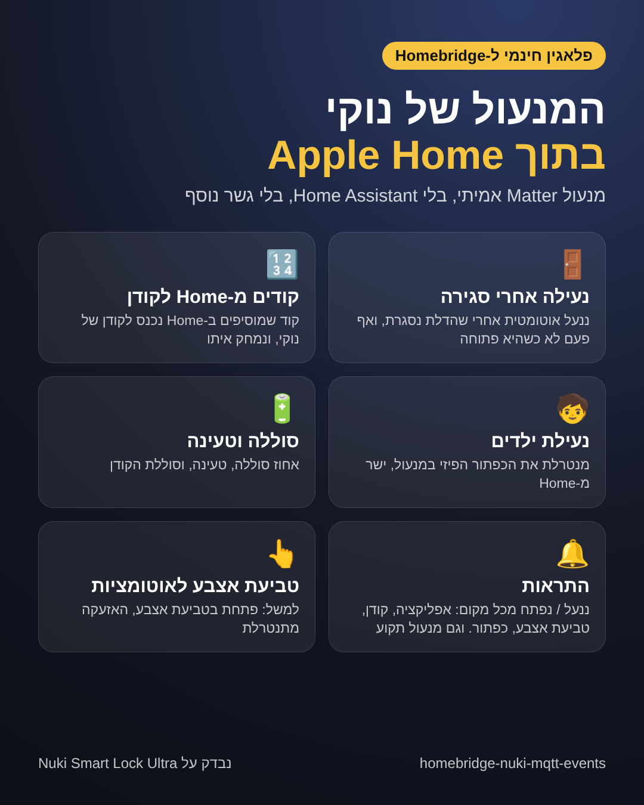
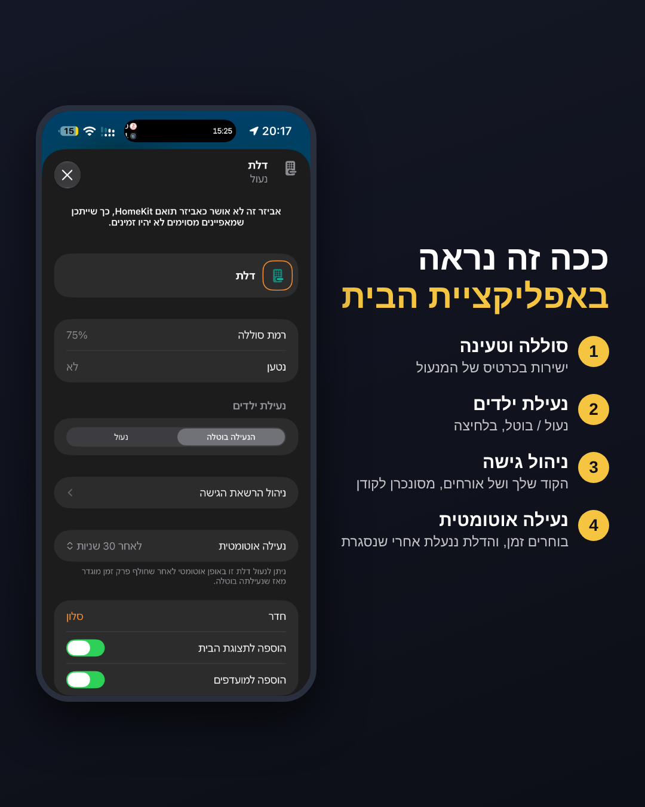
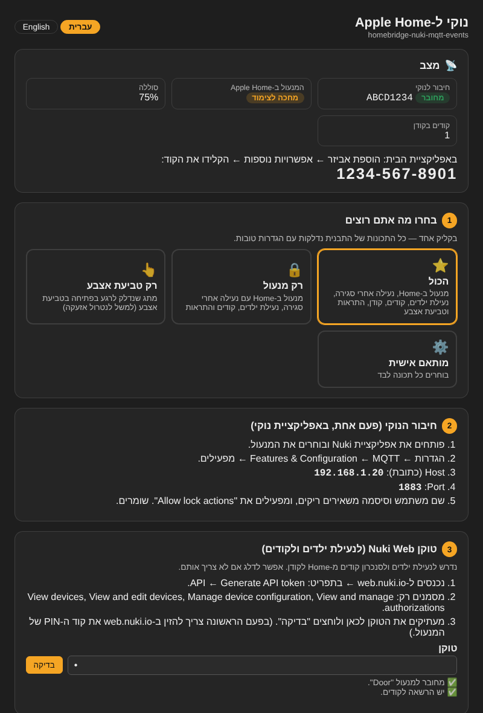

<div dir="rtl">

# נוקי ל‑Apple Home — homebridge-nuki-mqtt-events

**[English — click here](README.md)**

מנעול Nuki כ**מנעול Matter אמיתי באפליקציית הבית**, ישירות מ‑Homebridge. אין צורך ב‑Home Assistant, ב‑Mosquitto או בגשר נוסף. המנעול מדבר עם הפלאגין דרך **MQTT** מובנה.



| | |
|---|---|
| 🚪 **נעילה אחרי סגירה** | ננעל לבד אחרי שהדלת נסגרת (הזמן נקבע באפליקציית הבית), ואף פעם לא כשהיא פתוחה. עובד עם כל חיישן דלת (Aqara, Eve…). |
| 🔓 **כפתור פתיחת דלת** | ב‑Home מופיע "פתיחה" ליד "ביטול נעילה", כדי לפתוח את הדלת. |
| 🔢 **קודים מ‑Home לקודן** | קודים שמוסיפים ב‑Home (ניהול גישה) נכנסים לקודן של נוקי, משתנים ונמחקים יחד עם Home. קודים לאורחים שומרים על **ימים / שעות / תאריכים**. |
| 🧒 **נעילת ילדים** | מנטרלת את הכפתור הפיזי על המנעול, ישר מכרטיס המנעול ב‑Home. |
| 🔋 **סוללה** | אחוז סוללה ומצב טעינה, והתראה על סוללה חלשה בקודן. |
| 🔔 **התראות** | "ננעל / נפתח" גם כשמשתמשים באפליקציית נוקי, בקודן, בטביעת אצבע או בכפתור. מנעול תקוע. |
| 🚨 **התראות דלת** | **פריצה** (הדלת נפתחה בזמן שהמנעול נעול) ו**דלת נשארה פתוחה** (אחרי 5 דקות, וחוזר כל עוד היא פתוחה). |
| 👤 **מי פתח** | אפשר לחבר טביעת אצבע לקוד של האדם ב‑Home. |
| 👆 **מתג טביעת אצבע** | מתג לאוטומציות, למשל: פתיחה בטביעת אצבע ← נטרול אזעקה. |

**נבדק על Nuki Smart Lock Ultra.** אמור לעבוד על כל נוקי עם MQTT מובנה (Smart Lock Pro, Smart Lock Go, דור 4 ו‑Pro דור 4, ו‑3.0 Pro), אבל עוד לא נבדק עליהם. אשמח לשמוע ממי שמנסה.



---

## תוכן
1. [התקנה](#1-התקנה)
2. [דף ההגדרות — בוחרים תבנית](#2-דף-ההגדרות--בוחרים-תבנית)
3. [חיבור הנוקי (MQTT)](#3-חיבור-הנוקי-mqtt)
4. [טוקן Nuki Web (נעילת ילדים וקודים)](#4-טוקן-nuki-web-נעילת-ילדים-וקודים)
5. [הוספת המנעול לאפליקציית הבית](#5-הוספת-המנעול-לאפליקציית-הבית)
6. [חיבור חיישן דלת](#6-חיבור-חיישן-דלת)
7. [קודים ואורחים](#7-קודים-ואורחים)
8. [התראות](#8-התראות)
9. [מי פתח](#9-מי-פתח)
10. [מתג טביעת אצבע ← נטרול אזעקה](#10-מתג-טביעת-אצבע--נטרול-אזעקה)
11. [פתרון בעיות](#11-פתרון-בעיות)

---

## 1. התקנה
ב‑Homebridge: **Plugins** ← מחפשים **homebridge-nuki-mqtt-events** ← Install. נדרש Homebridge 1.8 ומעלה או 2.x, ו‑Node 20 ומעלה.

## 2. דף ההגדרות — בוחרים תבנית
פותחים את **ההגדרות** של הפלאגין. הדף ב**עברית או באנגלית** (בוחרים למעלה).



בוחרים תבנית אחת, וכל מה שבה נדלק עם הגדרות טובות:

| תבנית | מה מקבלים |
|---|---|
| ⭐ הכול | המנעול עם כל התכונות, הקודן כאביזר, התראות ומתג טביעת אצבע |
| 🔒 רק מנעול | המנעול עם כל התכונות וההתראות |
| 👆 רק טביעת אצבע | רק מתג שנדלק כשהדלת נפתחת בטביעת אצבע |
| ⚙️ מותאם אישית | בוחרים כל תכונה לבד |

בתחתית, **מתקדם** פותח את כל ההגדרות הטכניות (פורטים, ברוקר MQTT, קוד Matter).

## 3. חיבור הנוקי (MQTT)
פעם אחת, ב**אפליקציית נוקי**:
1. בוחרים את המנעול ← **הגדרות ← Features & Configuration ← MQTT** ← מפעילים.
2. **Host** = כתובת ה‑IP של שרת ה‑Homebridge (מופיעה בדף ההגדרות). **Port** = 1883.
3. שם משתמש וסיסמה משאירים ריקים. מפעילים **Allow lock actions**. שומרים.

בדף ההגדרות, בתיבת המצב למעלה, יופיע **מחובר** אחרי שהמנעול ישלח את ההודעה הראשונה.

## 4. טוקן Nuki Web (נעילת ילדים וקודים)
נדרש רק לנעילת ילדים ולקודים מ‑Home בקודן.
1. באפליקציית נוקי מפעילים **Nuki Web** למנעול. ב‑**web.nuki.io** מזינים פעם אחת את קוד ה‑PIN של המנעול.
2. ‏web.nuki.io ← **API** ← **Generate API token**. מסמנים **רק**:
   - View devices
   - View and edit devices
   - Manage device configuration
   - View and manage authorizations
3. מדביקים את הטוקן בדף ההגדרות ולוחצים **בדיקה**.

## 5. הוספת המנעול לאפליקציית הבית
שומרים את ההגדרות ומפעילים מחדש את Homebridge. דף ההגדרות (וגם הלוג) מציג **קוד צימוד**.
אפליקציית הבית ← **+** ← **הוספת אביזר** ← **אפשרויות נוספות** ← מקלידים את הקוד.

בכרטיס המנעול ב‑Home יופיעו: סוללה, **נעילת ילדים**, **ניהול גישה** ו**נעילה אוטומטית** (בוחרים זמן, למשל 30 שניות).

> מחקתם את המנעול מ‑Home ורוצים להוסיף מחדש? הפלאגין עדיין זוכר את הצימוד הקודם. מאפסים ומוסיפים שוב:
> ```bash
> sudo hb-service stop && sudo rm -rf /var/lib/homebridge/nuki-matter-lock && sudo hb-service start
> ```

## 6. חיבור חיישן דלת
כדי שהמנעול יידע מתי הדלת פתוחה, הפלאגין יוצר מתג בשם **Door Open**. מחברים אליו את חיישן הדלת בשתי אוטומציות באפליקציית הבית:
1. כשחיישן הדלת **נפתח** ← להדליק את **Door Open**.
2. כשחיישן הדלת **נסגר** ← לכבות את **Door Open**.

מעכשיו הנעילה האוטומטית מחכה שהדלת תיסגר, וההתראות יודעות מתי היא פתוחה.

## 7. קודים ואורחים
בכרטיס המנעול ב‑Home ← **ניהול גישה**: מוסיפים את הקוד שלכם, או אורח עם קוד.
- הקוד מופיע בקודן של נוקי תוך שניות, בשם **Apple Home** (כשיש כמה: Apple Home 1, ‏Apple Home 2…).
- מוחקים ב‑Home ← נמחק מהקודן.
- אורח שמוגבל לימים / שעות / תאריכים ← הקוד בקודן מקבל את אותה הגבלה.
- **קוד לקודן: 6 ספרות מ‑1 עד 9 (בלי 0), ולא מתחיל ב‑12.** קוד אחר עובד רק ב‑Home.

קודים שמוסיפים ישירות באפליקציית נוקי — הפלאגין לא נוגע בהם.

## 8. התראות
נוספים ל‑Home שני חיישנים (מפעילים להם התראות באפליקציית הבית):
- **Door Forced Open** — נפתח כשהדלת נפתחת בזמן שהמנעול נעול (פריצה).
- **Door Left Open** — נפתח אחרי שהדלת פתוחה 5 דקות, ושוב כל 5 דקות כל עוד היא פתוחה.

את הדקות, החזרה והשמות קובעים בדף ההגדרות.

## 9. מי פתח
בדף ההגדרות, תחת **מי פתח**, מחברים כל אדם מאפליקציית נוקי (טביעת אצבע) לקוד שלו ב‑Home. מעכשיו פתיחה בטביעת אצבע מדווחת ל‑Home בתור אותו אדם.

## 10. מתג טביעת אצבע ← נטרול אזעקה
המתג **Nuki Fingerprint** נדלק לשנייה כשהדלת נפתחת בטביעת אצבע. אוטומציה באפליקציית הבית:
*כש‑Nuki Fingerprint נדלק ← להעביר את מערכת האבטחה לכבוי.*
כך האזעקה מתנטרלת רק בטביעת אצבע, ולא כשפותחים את הדלת מבפנים. בדף ההגדרות אפשר להוסיף עוד מתגים (למשל לקודים).

## 11. פתרון בעיות
| בעיה | פתרון |
|---|---|
| במצב כתוב "עוד לא התקבלה הודעה" | בדקו את ה‑MQTT באפליקציית נוקי (Host = ה‑IP של Homebridge, פורט 1883). |
| ב‑Home כתוב "אין תגובה" | הפעילו מחדש את Homebridge. עדיין לא? אפסו את הצימוד (סעיף 5) והוסיפו מחדש. |
| נעילה/פתיחה מ‑Home לא עושה כלום | הפעילו **Allow lock actions** בהגדרות ה‑MQTT של נוקי. |
| שגיאה 423 בנעילת ילדים בלוג | המנעול עוד החיל את השינוי הקודם; הפלאגין מנסה שוב לבד. |
| הקוד לא הגיע לקודן | בדקו את כללי הקוד (סעיף 7) ואת הרשאת הטוקן "View and manage authorizations". |
| העדכון נכשל עם `ETARGET` מיד אחרי פרסום | npm צריך כמה דקות; נסו שוב. |

הלוג מציג כל מה שהפלאגין עושה (`Matter lock:`, ‏`Access codes:`, ‏`Child lock`, ‏`ALERT:`).

## תמיכה
אם הפלאגין עוזר לכם: https://paypal.me/orenasher

</div>
