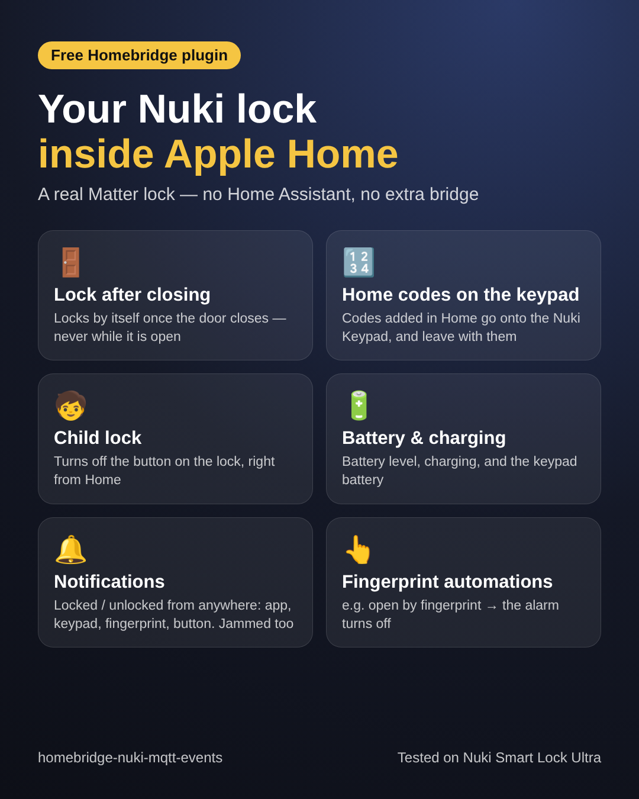
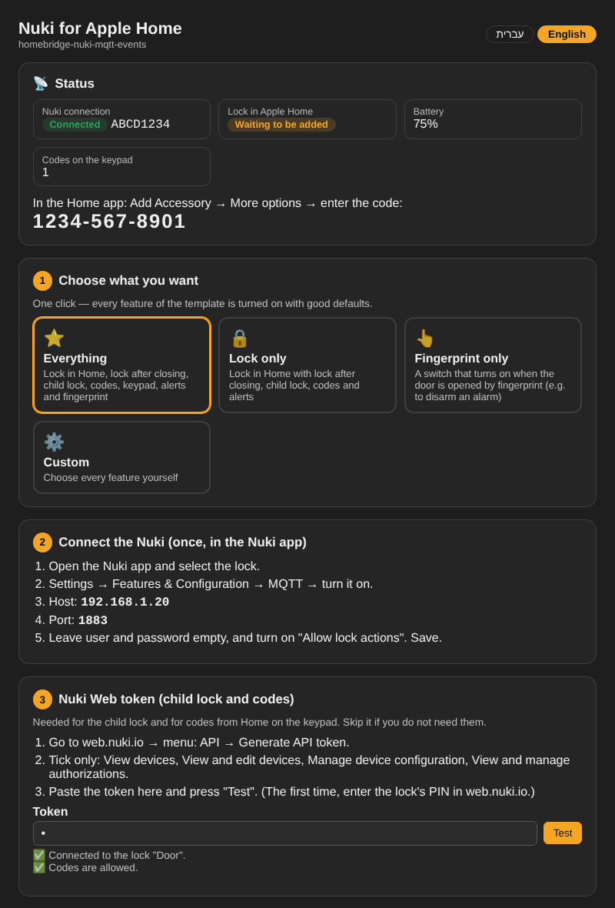

# Nuki for Apple Home — homebridge-nuki-mqtt-events

**[עברית — לחצו כאן](README.he.md)**

Your Nuki Smart Lock as a **real Matter lock in Apple Home**, straight from Homebridge, with no Home Assistant, Mosquitto or extra bridge. The lock talks to the plugin over its built-in **MQTT**.



| | |
|---|---|
| 🚪 **Lock after closing** | Locks by itself once the door closes (time set in the Home app), and never while it is open. Works with any door sensor (Aqara, Eve…). |
| 🔓 **Unlatch button** | Home shows "Unlatch" next to Unlock, to open the door. |
| 🔢 **Home codes on the keypad** | Codes added in Home (Manage Access) go onto the Nuki Keypad, are changed and removed with Home. Guest codes keep their **days / hours / dates**. |
| 🧒 **Child lock** | Turns off the physical button on the lock, right from the lock in Home. |
| 🔋 **Battery** | Battery level and charging state; low-battery warning for the keypad. |
| 🔔 **Notifications** | "Locked / Unlocked" also when the lock is used from the Nuki app, keypad, fingerprint or button. Jammed lock. |
| 🚨 **Door alerts** | **Forced entry** (door opened while locked) and **door left open** (after 5 minutes, repeating while it stays open). |
| 👆 **Fingerprint switch** | A switch for automations, e.g. open by fingerprint → disarm the alarm. |

**Tested on the Nuki Smart Lock Ultra.** It should work with every Nuki that has built-in MQTT (Smart Lock Pro, Smart Lock Go, Smart Lock 4th gen / Pro 4th gen, Smart Lock 3.0 Pro), but those have not been tested yet — reports are welcome.

---

## Contents
1. [Install](#1-install)
2. [Settings page — pick a setup](#2-settings-page--pick-a-setup)
3. [Connect the Nuki (MQTT)](#3-connect-the-nuki-mqtt)
4. [Nuki Web token (child lock & codes)](#4-nuki-web-token-child-lock--codes)
5. [Add the lock to the Home app](#5-add-the-lock-to-the-home-app)
6. [Connect a door sensor](#6-connect-a-door-sensor)
7. [Codes and guests](#7-codes-and-guests)
8. [Alerts](#8-alerts)
9. [Fingerprint switch → disarm the alarm](#9-fingerprint-switch--disarm-the-alarm)
10. [Troubleshooting](#10-troubleshooting)

---

## 1. Install
In Homebridge: **Plugins** → search **homebridge-nuki-mqtt-events** → Install. Homebridge 1.8+ or 2.x, Node 20+.

## 2. Settings page — pick a setup
Open the plugin's **Settings**. The page is in **English or Hebrew** (switch at the top).



Pick one setup — everything in it is turned on with good defaults:

| Setup | What you get |
|---|---|
| ⭐ Everything | The lock with all features, keypad accessory, alerts and fingerprint switch |
| 🔒 Lock only | The lock with all features and alerts |
| 👆 Fingerprint only | Just a switch that turns on when the door is opened by fingerprint |
| ⚙️ Custom | Choose every feature yourself |

At the bottom, **Advanced** opens every technical setting (ports, MQTT broker, Matter code).

## 3. Connect the Nuki (MQTT)
Once, in the **Nuki app**:
1. Select the lock → **Settings → Features & Configuration → MQTT** → turn it on.
2. **Host** = the IP of your Homebridge server (the settings page shows it). **Port** = 1883.
3. Leave user and password empty. Turn on **Allow lock actions**. Save.

The status box at the top of the settings page shows **Connected** once the lock has sent its first message.

## 4. Nuki Web token (child lock & codes)
Needed only for the child lock and for Home codes on the keypad.
1. In the Nuki app, turn on **Nuki Web** for the lock. At **web.nuki.io**, enter the lock's PIN once.
2. web.nuki.io → **API** → **Generate API token**. Tick **only**:
   - View devices
   - View and edit devices
   - Manage device configuration
   - View and manage authorizations
3. Paste the token in the settings page and press **Test**.

## 5. Add the lock to the Home app
Save the settings and restart Homebridge. The settings page (and the log) show a **pairing code**.
Home app → **+** → **Add Accessory** → **More options** → enter the code.

In the lock's page in Home you then have: battery, **Child Lock**, **Manage Access** and **Auto-Lock** (choose the time, e.g. 30 seconds).

> Removed the lock from Home and want to add it again? The plugin still remembers the old pairing. Reset it, then add it again:
> ```bash
> sudo hb-service stop && sudo rm -rf /var/lib/homebridge/nuki-matter-lock && sudo hb-service start
> ```

## 6. Connect a door sensor
So the lock knows when the door is open, the plugin creates a switch named **Door Open**. Link your door sensor to it with two automations in the Home app:
1. When the door sensor **opens** → turn **Door Open** on.
2. When the door sensor **closes** → turn **Door Open** off.

Now auto-lock waits for the door to close, and the alerts know when it is open.

## 7. Codes and guests
In the lock's page in Home → **Manage Access**: add your code, or a guest with a code.
- The code appears on the Nuki Keypad within seconds, named **Apple Home** (several codes: Apple Home 1, Apple Home 2…).
- Remove it in Home → it is removed from the keypad.
- Guest limited to certain days / hours / dates → the keypad code gets the same limits.
- **Keypad codes are 6 digits from 1 to 9 (no 0) and do not start with 12.** Any other code works in Home only.

Codes you add directly in the Nuki app are not touched by the plugin.

## 8. Alerts
Two sensors are added to Home (turn on their notifications in the Home app):
- **Door Forced Open** — opens when the door is opened while the lock is locked.
- **Door Left Open** — opens after the door has been open 5 minutes, and again every 5 minutes while it stays open.

Minutes, repeating and names are in the settings page.

Don't want a notification every time the door opens or closes? Settings page → **On the lock** → untick **Show "door open / closed" in Home**. Auto-lock and the alerts keep working.

## 9. Fingerprint switch → disarm the alarm
The switch **Nuki Fingerprint** turns on for a second when the door is opened by fingerprint. Home app automation:
*When Nuki Fingerprint turns on → set the Security System to Off.*
So the alarm is disarmed only by fingerprint, never when the door is opened from inside. More switches (e.g. for codes) can be added in the settings page.

## 10. Troubleshooting
| Problem | Fix |
|---|---|
| Status: "No message yet" | Check MQTT in the Nuki app (host = Homebridge IP, port 1883). |
| Home says "No response" | Restart Homebridge. Still not? Reset the pairing (section 5) and add it again. |
| Lock/unlock from Home does nothing | Turn on **Allow lock actions** in the Nuki MQTT settings. |
| Child lock error 423 in the log | The lock was still applying the previous change; the plugin retries by itself. |
| Code not on the keypad | Check the code rules (section 7) and the token right "View and manage authorizations". |
| Update fails with `ETARGET` right after publishing | npm needs a few minutes; try again. |
| No "Unlatch" button after updating from an older version | Home remembers what the lock offered when it was paired. Reset the pairing (section 5) and add the lock again. Until then, Unlock in Home only unlocks. |

The log shows everything the plugin does (`Matter lock:`, `Access codes:`, `Child lock`, `ALERT:`).

### MQTT event format (Nuki MQTT API)
`LockAction,Trigger,AuthID,CodeID,KeypadSource` — keypad source `1` = code, `2` = fingerprint.

## Support
If this plugin helps you: https://paypal.me/orenasher
